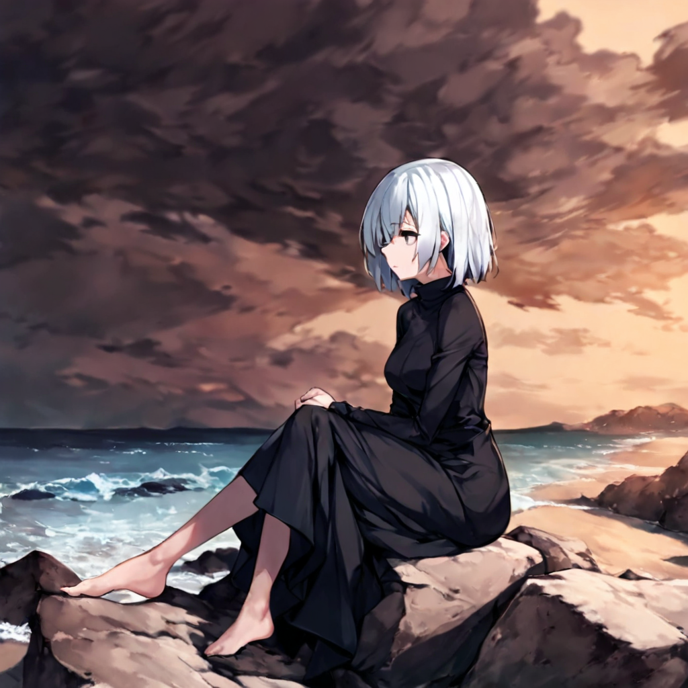
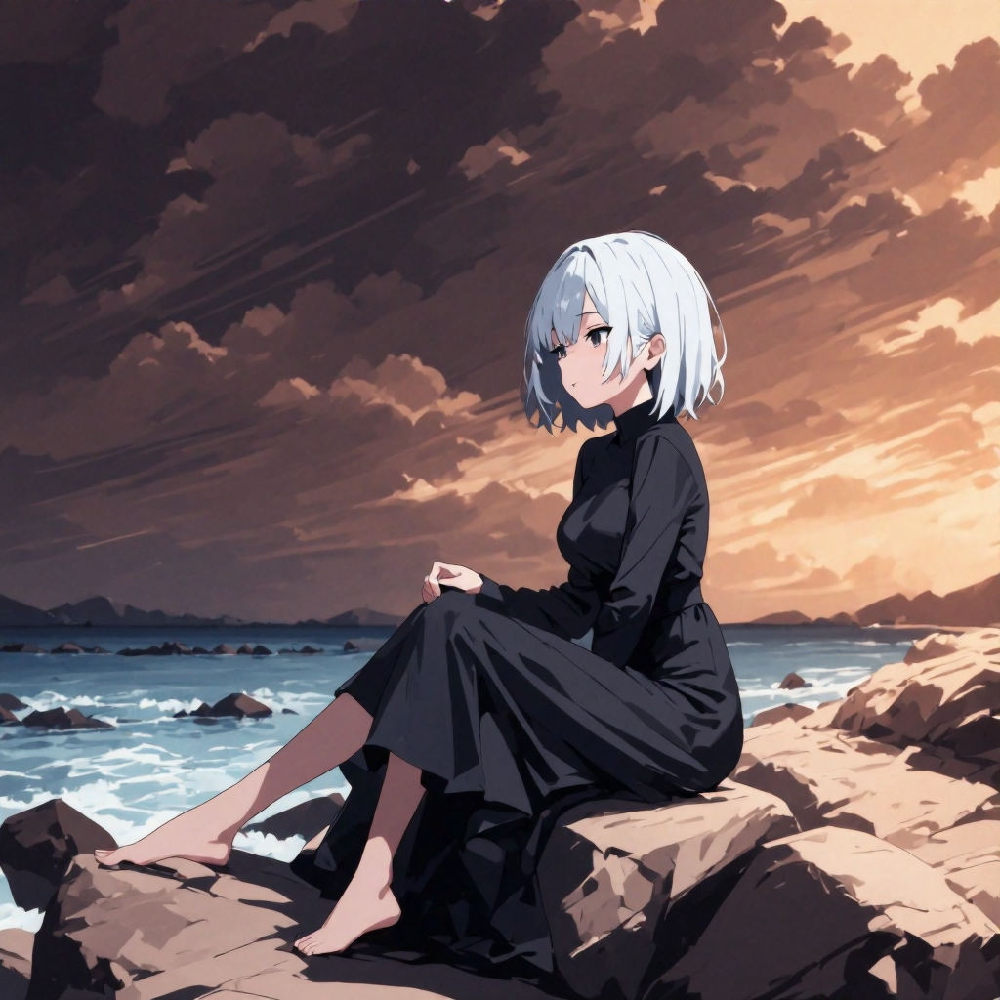
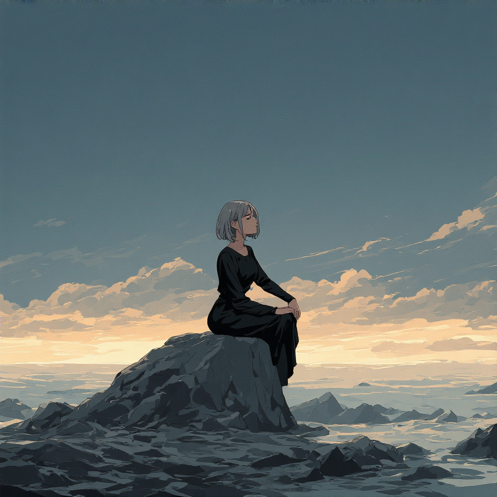
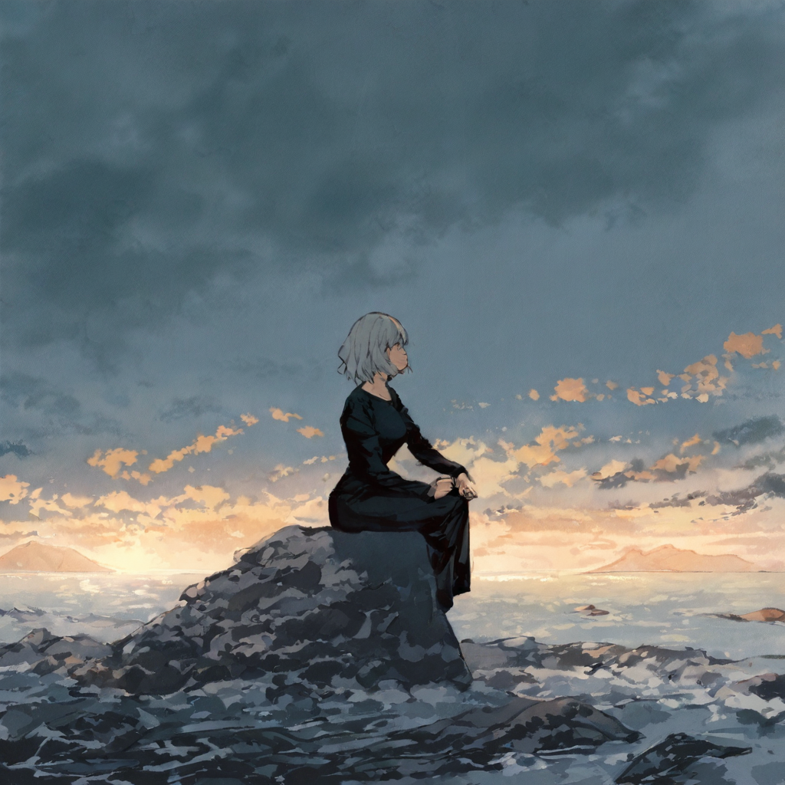
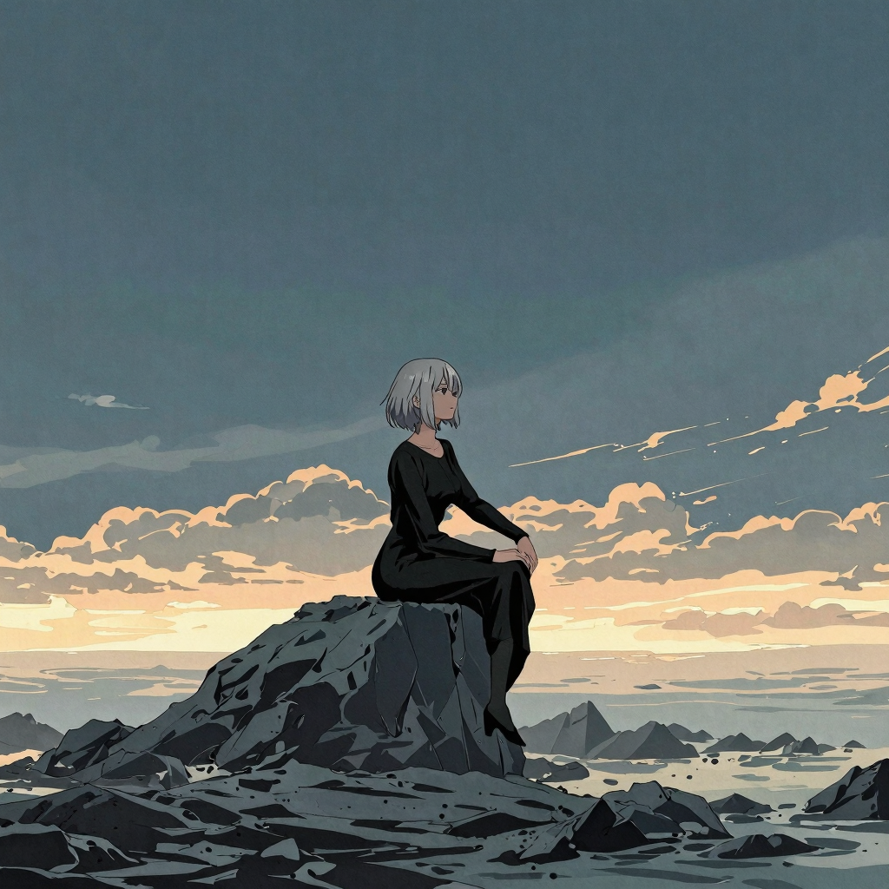
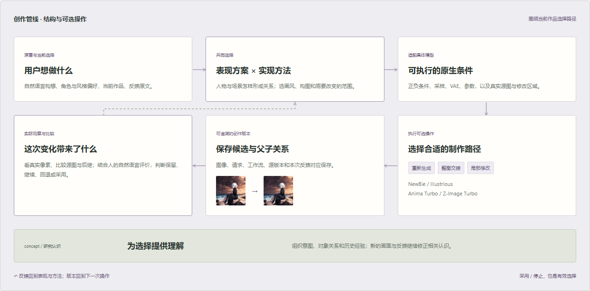
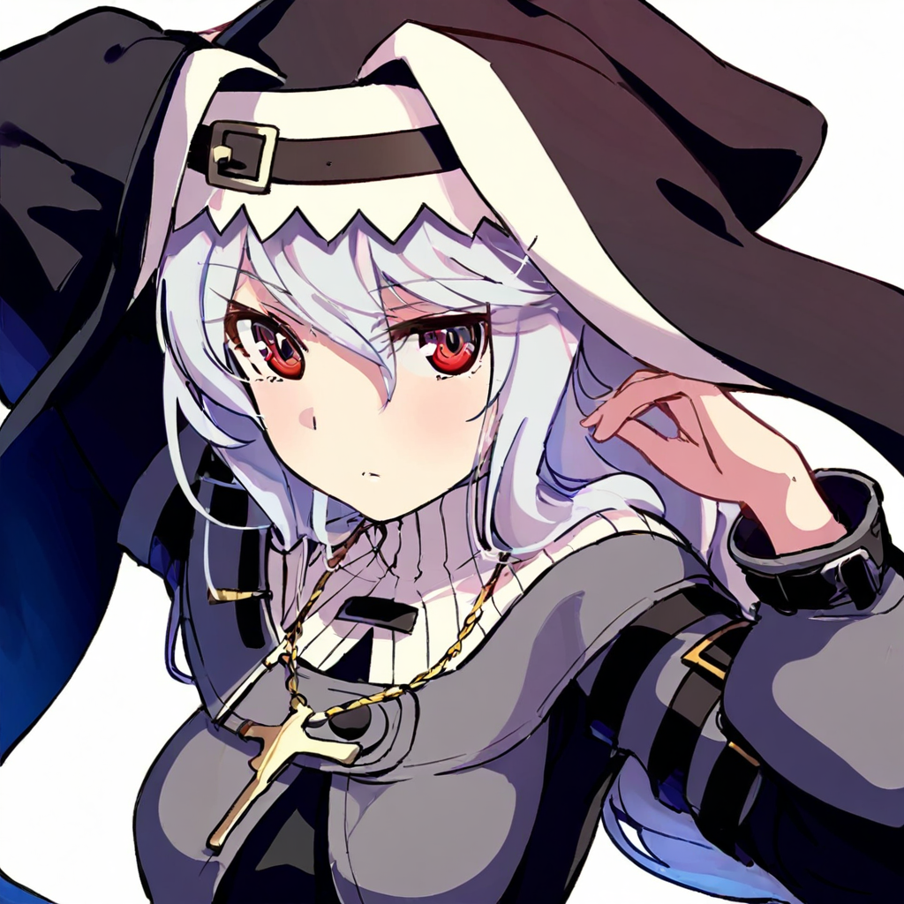

# Anime Pipeline Studio

围绕作品与版本发展的多模型创作管线。

我负责产品构思、组合实验与管线设计、实际画面的比较和取舍，结合 AI 协作实现工具。源图、模型条件和反馈共同参与后继制作。

## 从已有构图继续

| Illustrious 源图 | 交给 NewBie |
| --- | --- |
|  |  |

保留人物与礁石的构图关系，继续发展画面。真实实验：2026-09-18，seed 3407，denoise 0.3。

## 同一源图，两种画法方向

| 独立分支：Illustrious | 独立分支：Z-Image Turbo |
| --- | --- |
|  |  |

两个分支直接使用上方同一张源图。Illustrious 继续发展云层、岩石与柔和的绘画处理；Z-Image Turbo 形成另一种轮廓与色块组织。比较实际变化，再为作品选择后继。

源图 seed 42；两个后继 denoise 均为 0.5。各模型对参数的响应分别适配，这组材料用于比较具体创作方向。

## 完整创作管线

用户构想与当前作品 → 表现及实现选择 → 原生模型条件 → 生成、交接或局部修改 → 候选版本 → 实际观察与比较。

版本与反馈返回下一步选择，concept 与研究认识提供理解。共同起点可以分支，评价对应确切版本，用户原意持续保留。

[阅读管线设计](../PIPELINE.md) · [安装与使用](../README.md)

一个局部实例：保留大构图，继续塑造特色

Illustrious 源图到 NewBie 整图交接与脸部细化的实际结果，观察眼睛、表情和发丝的变化。

| 源图 | 后继 |
| --- | --- |
|  |  |

seed 42；整图交接强度 0.18，脸部细化 0.2。

技术支撑：Python、ComfyUI、模型条件适配、图像操作与本地 Web 工作区。

图像来自已有生成模型。早期实验为后续概念整理与管线设计提供材料；我的工作集中在创作系统、实验和选择，代码由 AI 协作推进。

syxxx00 · [bruce666vip@hotmail.com](mailto:bruce666vip@hotmail.com)
